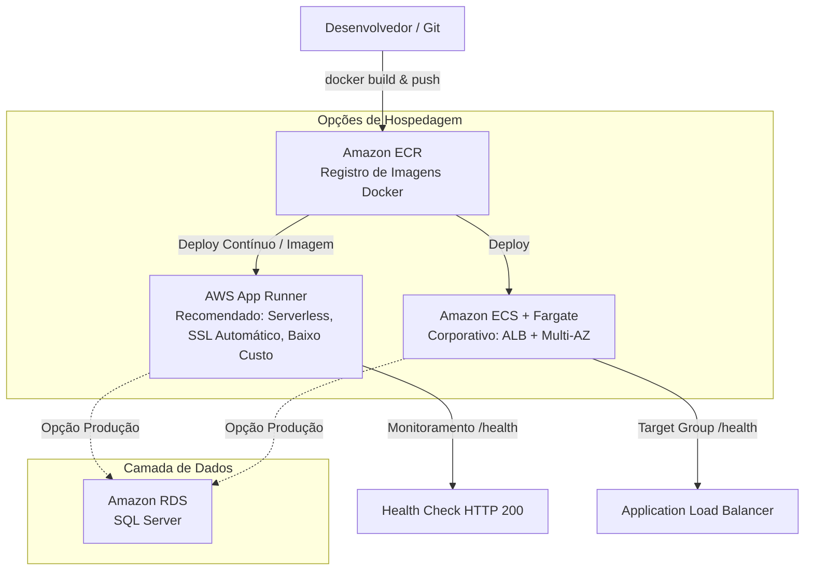

# Guia de Publicação da API em Docker na AWS (Amazon Web Services)

Este guia apresenta o passo a passo completo para empacotar a API **ANI Core (Portal Itapemirim)** em contêiner Docker e publicá-la na nuvem da AWS com alta disponibilidade, monitoramento de saúde e segurança.

---

## 1. Visão Geral da Arquitetura na AWS



---

## 2. Pré-requisitos

1. **Docker Desktop** instalado e em execução ([docker.com](https://www.docker.com/)).
2. **AWS CLI** instalado e configurado com suas credenciais:
   ```bash
   aws configure
   # Informe:
   # AWS Access Key ID: ********************
   # AWS Secret Access Key: ********************
   # Default region name: us-east-1 (ou sa-east-1 para São Paulo)
   # Default output format: json
   ```
3. Permissões IAM necessárias na conta AWS para:
   - Amazon ECR (`ecr:*`)
   - AWS App Runner (`apprunner:*`) ou Amazon ECS (`ecs:*`)

---

## 3. Teste do Contêiner Localmente

Antes de subir para a nuvem, você pode testar a imagem e a saúde da API localmente:

### Com Docker Compose (Recomendado):
```bash
# Sobe o contêiner em background
docker compose up -d --build

# Acompanha os logs
docker compose logs -f

# Testa o endpoint de saúde
curl http://localhost:5146/health
# Retorno esperado: Healthy (HTTP 200)

# Acessa o Swagger no navegador
# http://localhost:5146/index.html

# Derruba o contêiner mantendo os dados do volume
docker compose down
```

### Com Docker CLI puro:
```bash
# Build da imagem
docker build -t itapemirim-ani-api:latest .

# Execução na porta 5146
docker run -d --name itapemirim-api -p 5146:8080 itapemirim-ani-api:latest

# Verificação de status
docker ps
```

---

## 4. Passo a Passo: Publicando a Imagem no Amazon ECR

O **Amazon Elastic Container Registry (ECR)** é o repositório seguro e gerenciado da AWS para armazenar imagens Docker.

### 4.1 Definir variáveis de ambiente no seu terminal:

#### PowerShell (Windows):
```powershell
$AWS_REGION = "sa-east-1" # ou "us-east-1"
$AWS_ACCOUNT_ID = (aws sts get-caller-identity --query Account --output text)
$ECR_REPO = "portal-itapemirim-ani-api"
$IMAGE_URI = "$AWS_ACCOUNT_ID.dkr.ecr.$AWS_REGION.amazonaws.com/$ECR_REPO"
```

#### Bash / macOS / Linux:
```bash
export AWS_REGION="sa-east-1" # ou "us-east-1"
export AWS_ACCOUNT_ID=$(aws sts get-caller-identity --query Account --output text)
export ECR_REPO="portal-itapemirim-ani-api"
export IMAGE_URI="$AWS_ACCOUNT_ID.dkr.ecr.$AWS_REGION.amazonaws.com/$ECR_REPO"
```

### 4.2 Criar o repositório no ECR (apenas na 1ª vez):
```bash
aws ecr create-repository \
    --repository-name $ECR_REPO \
    --image-scanning-configuration scanOnPush=true \
    --region $AWS_REGION
```

### 4.3 Autenticar o Docker no Amazon ECR:
```powershell
# PowerShell:
aws ecr get-login-password --region $AWS_REGION | docker login --username AWS --password-stdin "$AWS_ACCOUNT_ID.dkr.ecr.$AWS_REGION.amazonaws.com"
```
```bash
# Bash:
aws ecr get-login-password --region $AWS_REGION | docker login --username AWS --password-stdin $IMAGE_URI
```

### 4.4 Gerar o Build, aplicar a Tag e Enviar (Push):
```bash
# 1. Compila a imagem local
docker build -t $ECR_REPO:latest .

# 2. Marca a tag com o endereço do ECR
docker tag $ECR_REPO:latest $IMAGE_URI:latest

# 3. Envia para a nuvem AWS
docker push $IMAGE_URI:latest
```

---

## 5. Opção Recomendada: Deploy no AWS App Runner

O **AWS App Runner** é o serviço totalmente gerenciado da AWS ideal para contêineres web:
- Gerencia balanceamento de carga, SSL/TLS gratuito, auto-scaling e health checks automaticamente.
- Não exige configuração manual de VPC complexa nem de EC2/Fargate.

### Passo a passo no Console da AWS:
1. Acesse o **AWS App Runner** no Console AWS.
2. Clique em **Create service**.
3. **Source**:
   - Repository type: **Container registry**
   - Provider: **Amazon ECR**
   - Container image URI: Selecione a imagem `$ECR_REPO:latest` do seu ECR.
   - Deployment trigger: Escolha **Automatic** (deploy automático a cada novo push) ou **Manual**.
4. **Configure service**:
   - Service name: `itapemirim-ani-api`
   - Virtual CPU & Memory: `1 vCPU`, `2 GB` (suficiente para iniciar).
   - **Port**: `8080` *(porta padrão do .NET 10 exposta no Dockerfile)*.
5. **Environment variables (Variáveis de Ambiente)**:
   | Chave | Valor Recomendado | Descrição |
   | :--- | :--- | :--- |
   | `ASPNETCORE_ENVIRONMENT` | `Production` | Ativa o modo de produção do ASP.NET |
   | `DatabaseProvider` | `SqlServer` *(ou `Sqlite`)* | Provedor de banco de dados |
   | `ConnectionStrings__DefaultConnection` | `Server=seu-rds.amazonaws.com;Database=portal_Itapemirim;User Id=ani_user;Password=...;TrustServerCertificate=True;` | String de conexão com o banco |
   | `Jwt__SecretKey` | *[Chave Secreta Forte >= 32 caracteres]* | Chave de assinatura dos tokens JWT |
   | `Jwt__Issuer` | `PortalItapemirimCore` | Emissor do Token |
   | `Jwt__Audience` | `PortalItapemirimApp` | Destinatário do Token |
6. **Health check**:
   - Protocol: `HTTP`
   - Path: `/health`
   - Interval: `10` segundos
   - Timeout: `5` segundos
   - Healthy threshold: `1`
   - Unhealthy threshold: `5`
7. Clique em **Create & deploy**.
8. Em poucos minutos a AWS disponibilizará a URL pública segura (ex: `https://xxxxxx.sa-east-1.awsapprunner.com`).

---

## 6. Opção Alternativa: Amazon ECS (Elastic Container Service com Fargate)

Para ambientes corporativos que já possuem infraestrutura VPC, NAT Gateways e Application Load Balancers dedicados:

1. **ECS Cluster**: Crie um Cluster do tipo **Serverless (Fargate)**.
2. **Task Definition**:
   - Tipo de Inicialização: `FARGATE`.
   - Sistema Operacional: `Linux/X86_64`.
   - Imagem do contêiner: `$IMAGE_URI:latest`.
   - Port mappings: Porta do contêiner `8080`, Protocolo `TCP`, App protocol `HTTP`.
   - Healthcheck:
     - Command: `CMD-SHELL, curl -f http://localhost:8080/health || exit 1`
     - Interval: `30`s, Timeout: `5`s, Retries: `3`.
3. **Application Load Balancer (ALB)**:
   - Target Group: Tipo `IP`, Porta `8080`, Health check path `/health`, Success code `200`.
   - Listener: Porta `443` HTTPS (com certificado do AWS Certificate Manager - ACM).
4. **ECS Service**:
   - Associa a Task Definition ao Target Group do ALB.
   - O ECS gerencia os contêineres, substituindo automaticamente qualquer instância que falhe no `/health`.

---

## 7. Boas Práticas de Segurança e Produção

1. **Segredos (AWS Secrets Manager ou Systems Manager Parameter Store)**:
   - Em vez de colocar senhas de banco ou segredos JWT em texto simples nas variáveis de ambiente, utilize o **AWS Secrets Manager** e referencie os ARNs diretamente no App Runner ou Task Definition do ECS.
2. **Banco de Dados em Nuvem**:
   - Para ambientes de produção com múltiplos contêineres rodando em paralelo, use o **Amazon RDS for SQL Server** ou PostgreSQL.
   - O SQLite funciona perfeitamente para testes e instâncias únicas, mas bancos relacionais baseados em rede (RDS) são o padrão para escalabilidade horizontal em contêineres.
3. **Logs Centralizados**:
   - A imagem já emite logs estruturados via console padrão (stdout/stderr), sendo capturados automaticamente pelo **Amazon CloudWatch Logs** tanto no App Runner quanto no ECS.
