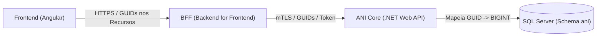

# Proposta de Arquitetura e Estrutura de Projetos .NET — ANI Core (Portal Itapemirim)

## 1. Visão Geral e Contexto

Este documento define a especificação arquitetural completa para a implementação do **ANI Core** em **.NET 8 / .NET 9**, alinhando rigorosamente:
1. A especificação de rotas e casos de uso em [endpoint_descricao.md](file:///c:/Users/Duilio%20Farias/source/repos/portal_ItapemirimCore/.doc/endpoint_descricao.md).
2. O script oficial de banco de dados SQL Server em [ani-schema.sql](file:///c:/Users/Duilio%20Farias/source/repos/portal_ItapemirimCore/.sql/ani-schema.sql).

### Contexto do Ecossistema e Identificação Pública Segura


> [!IMPORTANT]
> **Estratégia Anti-Fraude e Anti-Enumeração (IDOR Protection)**:
> O banco de dados utiliza uma estratégia híbrida:
> - **Chave Interna (`BIGINT IDENTITY(1,1)`)**: Utilizada internamente pelo EF Core para integridade referencial (FKs), junções (`JOINs`) de altíssima performance e chave primária clustered.
> - **Chave Pública Externa (`UNIQUEIDENTIFIER` / GUID)**: Gerada automaticamente via `DEFAULT (NEWSEQUENTIALID())` com índice único em cada tabela de domínio. **Essa é a única chave que o Frontend (Angular) e o BFF recebem e utilizam nas rotas REST**. Nenhum atacante consegue deduzir ou enumerar sequencialmente registros (`/api/v1/usuarios/1`, `/api/v1/usuarios/2`), eliminando vulnerabilidades de enumeração e scraping abusivo.

---

## 2. Tipos de Projetos .NET Recomendados

A solução é organizada seguindo os princípios de **Clean Architecture / Layered Architecture**:

| Nome do Projeto | Tipo .NET CLI | Finalidade e Responsabilidade |
| :--- | :--- | :--- |
| **`Itapemirim.Ani.Domain`** | `classlib` | **Entidades de Domínio (Models)**, Enums, Contratos de Repositório (`IRepository`), Exceções de Domínio e Regras Puras (ex: cálculo de permissões consolidadas). Não possui dependências externas de banco ou frameworks web. |
| **`Itapemirim.Ani.Application`** | `classlib` | **Serviços de Aplicação (Services)**, DTOs (Request / Response baseados em GUID), Validadores (`FluentValidation`), Mapeadores e Interfaces de Serviços Externos/Infraestrutura. |
| **`Itapemirim.Ani.Infrastructure`** | `classlib` | **Acesso a Dados e Persistência**: EF Core (`AniDbContext`), configurações Fluent API espelhando o schema `ani`, mapeamento de GUIDs/NEWSEQUENTIALID, repositórios concretos, hashing de senhas (`BCrypt`) e interceptor de auditoria. |
| **`Itapemirim.Ani.Api`** | `webapi` | **API REST**: Controllers HTTP (`/api/v1/...`) recebendo GUIDs nos parâmetros de rota, Middlewares (tratamento global de exceções, CorrelationId), Swagger/OpenAPI e injeção de dependências (`DependencyInjection`). |
| **`Itapemirim.Ani.UnitTests`** | `xunit` | Testes unitários para regras de domínio, services de aplicação e validações de DTOs. |
| **`Itapemirim.Ani.IntegrationTests`** | `xunit` | Testes de integração de ponta a ponta para Controllers REST, persistência EF Core e fluxo com banco de dados. |

---

## 3. Mapeamento Completo de Campos: Banco de Dados (`ani-schema.sql`) vs C# (`Domain`)

Abaixo está o mapeamento campo a campo de cada uma das 6 tabelas do schema `ani` incluindo as colunas GUID públicas:

### 3.1. Tabela `[ani].[Usuario]`

| Coluna SQL | Tipo SQL | Nulo? | Default SQL | Propriedade C# | Tipo C# | Regras / Índices / Constraints |
| :--- | :--- | :---: | :--- | :--- | :--- | :--- |
| `UsuarioId` | `BIGINT IDENTITY(1,1)` | Não | Identity | `UsuarioId` | `long` | Chave Primária Clustered interna (`PK_Usuario`) |
| `UsuarioGuid` | `UNIQUEIDENTIFIER` | Não | `NEWSEQUENTIALID()` | `UsuarioGuid` | `Guid` | **Identificador público para o Front/BFF**. Índice Único: `UX_Usuario_UsuarioGuid` |
| `Nome` | `NVARCHAR(150)` | Não | - | `Nome` | `string` | Obrigatório, máx 150 caracteres |
| `Login` | `NVARCHAR(100)` | Não | - | `Login` | `string` | Obrigatório, máx 100 caracteres, Índice Único: `UX_Usuario_Login` |
| `Email` | `NVARCHAR(254)` | Sim | NULL | `Email` | `string?` | Opcional, máx 254 caracteres, Índice Único Filtrado: `UX_Usuario_Email` (`WHERE [Email] IS NOT NULL`) |
| `SenhaHash` | `NVARCHAR(512)` | Não | - | `SenhaHash` | `string` | Obrigatório, máx 512 caracteres. **Nunca exposto em DTOs** |
| `Status` | `NVARCHAR(20)` | Não | `'Ativo'` | `Status` | `UsuarioStatus` | Enum C#. Check Constraint `CK_Usuario_Status`: `IN ('Ativo', 'Inativo', 'Bloqueado')` |
| `CriadoEmUtc` | `DATETIME2(3)` | Não | `SYSUTCDATETIME()` | `CriadoEmUtc` | `DateTime` | Data/hora UTC de criação |
| `AtualizadoEmUtc` | `DATETIME2(3)` | Sim | NULL | `AtualizadoEmUtc` | `DateTime?` | Data/hora UTC da última alteração |

---

### 3.2. Tabela `[ani].[Perfil]`

| Coluna SQL | Tipo SQL | Nulo? | Default SQL | Propriedade C# | Tipo C# | Regras / Índices / Constraints |
| :--- | :--- | :---: | :--- | :--- | :--- | :--- |
| `PerfilId` | `BIGINT IDENTITY(1,1)` | Não | Identity | `PerfilId` | `long` | Chave Primária Clustered interna (`PK_Perfil`) |
| `PerfilGuid` | `UNIQUEIDENTIFIER` | Não | `NEWSEQUENTIALID()` | `PerfilGuid` | `Guid` | **Identificador público para o Front/BFF**. Índice Único: `UX_Perfil_PerfilGuid` |
| `Nome` | `NVARCHAR(100)` | Não | - | `Nome` | `string` | Obrigatório, máx 100 caracteres, Índice Único: `UX_Perfil_Nome` |
| `Descricao` | `NVARCHAR(500)` | Sim | NULL | `Descricao` | `string?` | Opcional, máx 500 caracteres |
| `Ativo` | `BIT` | Não | `1` | `Ativo` | `bool` | Flag de status ativo/inativo |
| `CriadoEmUtc` | `DATETIME2(3)` | Não | `SYSUTCDATETIME()` | `CriadoEmUtc` | `DateTime` | Data/hora UTC de criação |
| `AtualizadoEmUtc` | `DATETIME2(3)` | Sim | NULL | `AtualizadoEmUtc` | `DateTime?` | Data/hora UTC da última alteração |

---

### 3.3. Tabela `[ani].[Permissao]`

| Coluna SQL | Tipo SQL | Nulo? | Default SQL | Propriedade C# | Tipo C# | Regras / Índices / Constraints |
| :--- | :--- | :---: | :--- | :--- | :--- | :--- |
| `PermissaoId` | `BIGINT IDENTITY(1,1)` | Não | Identity | `PermissaoId` | `long` | Chave Primária Clustered interna (`PK_Permissao`) |
| `PermissaoGuid` | `UNIQUEIDENTIFIER` | Não | `NEWSEQUENTIALID()` | `PermissaoGuid` | `Guid` | **Identificador público para o Front/BFF**. Índice Único: `UX_Permissao_PermissaoGuid` |
| `Codigo` | `NVARCHAR(150)` | Não | - | `Codigo` | `string` | Código de autorização (ex: `USUARIO_CRIAR`). Índice Único: `UX_Permissao_Codigo` |
| `Nome` | `NVARCHAR(150)` | Não | - | `Nome` | `string` | Nome legível, máx 150 caracteres |
| `Descricao` | `NVARCHAR(500)` | Sim | NULL | `Descricao` | `string?` | Opcional, máx 500 caracteres |
| `Recurso` | `NVARCHAR(100)` | Não | - | `Recurso` | `string` | Módulo/entidade alvo (ex: `Usuarios`, `Perfis`, `Auditoria`) |
| `Acao` | `NVARCHAR(50)` | Não | - | `Acao` | `string` | Ação permitida (ex: `Consultar`, `Cadastrar`, `Atualizar`, `Inativar`) |
| `DscUrl` | `NVARCHAR(250)` | Sim | NULL | `DscUrl` | `string?` | Rota/caminho da tela chamada no front (ex: `/usuarios`, `/usuarios/novo`) |
| `Ativo` | `BIT` | Não | `1` | `Ativo` | `bool` | Flag de permissão ativa no catálogo |
| `CriadoEmUtc` | `DATETIME2(3)` | Não | `SYSUTCDATETIME()` | `CriadoEmUtc` | `DateTime` | Data/hora UTC de criação |
| `AtualizadoEmUtc` | `DATETIME2(3)` | Sim | NULL | `AtualizadoEmUtc` | `DateTime?` | Data/hora UTC da última alteração |

---

### 3.4. Tabela `[ani].[UsuarioPerfil]` (Associação Usuário <-> Perfil com Histórico)

| Coluna SQL | Tipo SQL | Nulo? | Default SQL | Propriedade C# | Tipo C# | Regras / Índices / Constraints |
| :--- | :--- | :---: | :--- | :--- | :--- | :--- |
| `UsuarioPerfilId` | `BIGINT IDENTITY(1,1)` | Não | Identity | `UsuarioPerfilId` | `long` | Chave Primária Clustered (`PK_UsuarioPerfil`) |
| `UsuarioPerfilGuid` | `UNIQUEIDENTIFIER` | Não | `NEWSEQUENTIALID()` | `UsuarioPerfilGuid` | `Guid` | Identificador público único do vínculo. Índice Único: `UX_UsuarioPerfil_UsuarioPerfilGuid` |
| `UsuarioId` | `BIGINT` | Não | - | `UsuarioId` | `long` | Chave Estrangeira (`FK_UsuarioPerfil_Usuario`) -> `[ani].[Usuario]` |
| `PerfilId` | `BIGINT` | Não | - | `PerfilId` | `long` | Chave Estrangeira (`FK_UsuarioPerfil_Perfil`) -> `[ani].[Perfil]` |
| `ConcedidoPorUsuarioId` | `BIGINT` | Sim | NULL | `ConcedidoPorUsuarioId`| `long?` | Chave Estrangeira (`FK_UsuarioPerfil_ConcedidoPor`) -> `[ani].[Usuario]` |
| `ConcedidoEmUtc` | `DATETIME2(3)` | Não | `SYSUTCDATETIME()` | `ConcedidoEmUtc` | `DateTime` | Data/hora UTC da concessão |
| `RevogadoPorUsuarioId` | `BIGINT` | Sim | NULL | `RevogadoPorUsuarioId` | `long?` | Chave Estrangeira (`FK_UsuarioPerfil_RevogadoPor`) -> `[ani].[Usuario]` |
| `RevogadoEmUtc` | `DATETIME2(3)` | Sim | NULL | `RevogadoEmUtc` | `DateTime?` | Data/hora UTC da revogação |

**Constraints e Índices**:
- Check Constraint `CK_UsuarioPerfil_Revogacao`: `([RevogadoEmUtc] IS NULL OR [RevogadoEmUtc] >= [ConcedidoEmUtc])`.
- Índice Único Filtrado `UX_UsuarioPerfil_Ativo`: Em `([UsuarioId], [PerfilId]) WHERE [RevogadoEmUtc] IS NULL`.
- Índice de Performance `IX_UsuarioPerfil_PerfilId`: Em `([PerfilId], [UsuarioId])`.

---

### 3.5. Tabela `[ani].[PerfilPermissao]` (Associação Perfil <-> Permissão com Histórico)

| Coluna SQL | Tipo SQL | Nulo? | Default SQL | Propriedade C# | Tipo C# | Regras / Índices / Constraints |
| :--- | :--- | :---: | :--- | :--- | :--- | :--- |
| `PerfilPermissaoId` | `BIGINT IDENTITY(1,1)` | Não | Identity | `PerfilPermissaoId` | `long` | Chave Primária Clustered (`PK_PerfilPermissao`) |
| `PerfilPermissaoGuid` | `UNIQUEIDENTIFIER` | Não | `NEWSEQUENTIALID()` | `PerfilPermissaoGuid` | `Guid` | Identificador público único do vínculo. Índice Único: `UX_PerfilPermissao_PerfilPermissaoGuid` |
| `PerfilId` | `BIGINT` | Não | - | `PerfilId` | `long` | Chave Estrangeira (`FK_PerfilPermissao_Perfil`) -> `[ani].[Perfil]` |
| `PermissaoId` | `BIGINT` | Não | - | `PermissaoId` | `long` | Chave Estrangeira (`FK_PerfilPermissao_Permissao`) -> `[ani].[Permissao]` |
| `ConcedidoPorUsuarioId` | `BIGINT` | Sim | NULL | `ConcedidoPorUsuarioId`| `long?` | Chave Estrangeira (`FK_PerfilPermissao_ConcedidoPor`) -> `[ani].[Usuario]` |
| `ConcedidoEmUtc` | `DATETIME2(3)` | Não | `SYSUTCDATETIME()` | `ConcedidoEmUtc` | `DateTime` | Data/hora UTC da concessão |
| `RevogadoPorUsuarioId` | `BIGINT` | Sim | NULL | `RevogadoPorUsuarioId` | `long?` | Chave Estrangeira (`FK_PerfilPermissao_RevogadoPor`) -> `[ani].[Usuario]` |
| `RevogadoEmUtc` | `DATETIME2(3)` | Sim | NULL | `RevogadoEmUtc` | `DateTime?` | Data/hora UTC da revogação |

**Constraints e Índices**:
- Check Constraint `CK_PerfilPermissao_Revogacao`: `([RevogadoEmUtc] IS NULL OR [RevogadoEmUtc] >= [ConcedidoEmUtc])`.
- Índice Único Filtrado `UX_PerfilPermissao_Ativa`: Em `([PerfilId], [PermissaoId]) WHERE [RevogadoEmUtc] IS NULL`.
- Índice de Performance `IX_PerfilPermissao_PermissaoId`: Em `([PermissaoId], [PerfilId])`.

---

### 3.6. Tabela `[ani].[Auditoria]`

| Coluna SQL | Tipo SQL | Nulo? | Default SQL | Propriedade C# | Tipo C# | Regras / Índices / Constraints |
| :--- | :--- | :---: | :--- | :--- | :--- | :--- |
| `AuditoriaId` | `BIGINT IDENTITY(1,1)` | Não | Identity | `AuditoriaId` | `long` | Chave Primária Clustered interna (`PK_Auditoria`) |
| `AuditoriaGuid` | `UNIQUEIDENTIFIER` | Não | `NEWSEQUENTIALID()` | `AuditoriaGuid` | `Guid` | **Identificador público para o Front/BFF**. Índice Único: `UX_Auditoria_AuditoriaGuid` |
| `AtorUsuarioId` | `BIGINT` | Sim | NULL | `AtorUsuarioId` | `long?` | Chave Estrangeira (`FK_Auditoria_Ator`) -> `[ani].[Usuario]` |
| `Acao` | `NVARCHAR(20)` | Não | - | `Acao` | `TipoAcaoAuditoria`| Enum C#. Check `CK_Auditoria_Acao`: `IN ('INCLUSAO', 'ALTERACAO', 'REMOCAO')` |
| `Entidade` | `NVARCHAR(100)` | Não | - | `Entidade` | `string` | Nome da entidade alterada |
| `EntidadeId` | `NVARCHAR(128)` | Não | - | `EntidadeId` | `string` | Identificador (GUID em string) do registro auditado |
| `Resultado` | `NVARCHAR(20)` | Não | - | `Resultado` | `ResultadoAuditoria`| Enum C#. Check `CK_Auditoria_Resultado`: `IN ('SUCESSO', 'FALHA')` |
| `Origem` | `NVARCHAR(100)` | Sim | NULL | `Origem` | `string?` | Origem da requisição |
| `CorrelationId` | `UNIQUEIDENTIFIER`| Sim | NULL | `CorrelationId` | `Guid?` | Identificador unificado para rastreamento fim a fim |
| `OcorridoEmUtc` | `DATETIME2(3)` | Não | `SYSUTCDATETIME()` | `OcorridoEmUtc` | `DateTime` | Data/hora UTC do evento |

**Constraints e Índices**:
- Índice de Busca Recente `IX_Auditoria_OcorridoEmUtc`: Em `([OcorridoEmUtc] DESC)`.
- Índice de Busca por Ator `IX_Auditoria_Ator_OcorridoEmUtc`: Em `([AtorUsuarioId], [OcorridoEmUtc] DESC)`.

---

## 4. Modelagem C# das Entidades de Domínio (`Domain/Entities`)

### 4.1. Entidade `Usuario`

```csharp
namespace Itapemirim.Ani.Domain.Entities;

using Itapemirim.Ani.Domain.Enums;

public class Usuario
{
    public long UsuarioId { get; private set; }
    public Guid UsuarioGuid { get; private set; }
    public string Nome { get; private set; } = null!;
    public string Login { get; private set; } = null!;
    public string? Email { get; private set; }
    public string SenhaHash { get; private set; } = null!;
    public UsuarioStatus Status { get; private set; } = UsuarioStatus.Ativo;
    public DateTime CriadoEmUtc { get; private set; }
    public DateTime? AtualizadoEmUtc { get; private set; }

    public ICollection<UsuarioPerfil> PerfisAssociados { get; private set; } = new List<UsuarioPerfil>();
    public ICollection<UsuarioPerfil> PerfisConcedidos { get; private set; } = new List<UsuarioPerfil>();
    public ICollection<UsuarioPerfil> PerfisRevogados { get; private set; } = new List<UsuarioPerfil>();
    public ICollection<PerfilPermissao> PermissoesConcedidas { get; private set; } = new List<PerfilPermissao>();
    public ICollection<PerfilPermissao> PermissoesRevogadas { get; private set; } = new List<PerfilPermissao>();
    public ICollection<Auditoria> AuditoriasRealizadas { get; private set; } = new List<Auditoria>();

    protected Usuario() { }

    public Usuario(string nome, string login, string? email, string senhaHash, UsuarioStatus status = UsuarioStatus.Ativo)
    {
        UsuarioGuid = Guid.NewGuid();
        Nome = nome;
        Login = login;
        Email = email;
        SenhaHash = senhaHash;
        Status = status;
        CriadoEmUtc = DateTime.UtcNow;
    }

    public void AtualizarDados(string nome, string? email, UsuarioStatus status)
    {
        Nome = nome;
        Email = email;
        Status = status;
        AtualizadoEmUtc = DateTime.UtcNow;
    }

    public void Inativar()
    {
        Status = UsuarioStatus.Inativo;
        AtualizadoEmUtc = DateTime.UtcNow;
    }

    public void AtualizarSenha(string novoHash)
    {
        SenhaHash = novoHash;
        AtualizadoEmUtc = DateTime.UtcNow;
    }
}
```

### 4.2. Entidade `Perfil`

```csharp
namespace Itapemirim.Ani.Domain.Entities;

public class Perfil
{
    public long PerfilId { get; private set; }
    public Guid PerfilGuid { get; private set; }
    public string Nome { get; private set; } = null!;
    public string? Descricao { get; private set; }
    public bool Ativo { get; private set; } = true;
    public DateTime CriadoEmUtc { get; private set; }
    public DateTime? AtualizadoEmUtc { get; private set; }

    public ICollection<UsuarioPerfil> Usuarios { get; private set; } = new List<UsuarioPerfil>();
    public ICollection<PerfilPermissao> Permissoes { get; private set; } = new List<PerfilPermissao>();

    protected Perfil() { }

    public Perfil(string nome, string? descricao, bool ativo = true)
    {
        PerfilGuid = Guid.NewGuid();
        Nome = nome;
        Descricao = descricao;
        Ativo = ativo;
        CriadoEmUtc = DateTime.UtcNow;
    }

    public void Atualizar(string nome, string? descricao, bool ativo)
    {
        Nome = nome;
        Descricao = descricao;
        Ativo = ativo;
        AtualizadoEmUtc = DateTime.UtcNow;
    }

    public void Desativar()
    {
        Ativo = false;
        AtualizadoEmUtc = DateTime.UtcNow;
    }
}
```

### 4.3. Entidade `Permissao`

```csharp
namespace Itapemirim.Ani.Domain.Entities;

public class Permissao
{
    public long PermissaoId { get; private set; }
    public Guid PermissaoGuid { get; private set; }
    public string Codigo { get; private set; } = null!;
    public string Nome { get; private set; } = null!;
    public string? Descricao { get; private set; }
    public string Recurso { get; private set; } = null!;
    public string Acao { get; private set; } = null!;
    public bool Ativo { get; private set; } = true;
    public DateTime CriadoEmUtc { get; private set; }
    public DateTime? AtualizadoEmUtc { get; private set; }

    public ICollection<PerfilPermissao> Perfis { get; private set; } = new List<PerfilPermissao>();

    protected Permissao() { }

    public Permissao(string codigo, string nome, string? descricao, string recurso, string acao, bool ativo = true)
    {
        PermissaoGuid = Guid.NewGuid();
        Codigo = codigo;
        Nome = nome;
        Descricao = descricao;
        Recurso = recurso;
        Acao = acao;
        Ativo = ativo;
        CriadoEmUtc = DateTime.UtcNow;
    }

    public void Atualizar(string nome, string? descricao, string recurso, string acao, bool ativo)
    {
        Nome = nome;
        Descricao = descricao;
        Recurso = recurso;
        Acao = acao;
        Ativo = ativo;
        AtualizadoEmUtc = DateTime.UtcNow;
    }

    public void Desativar()
    {
        Ativo = false;
        AtualizadoEmUtc = DateTime.UtcNow;
    }
}
```

### 4.4. Entidade `UsuarioPerfil`

```csharp
namespace Itapemirim.Ani.Domain.Entities;

public class UsuarioPerfil
{
    public long UsuarioPerfilId { get; private set; }
    public Guid UsuarioPerfilGuid { get; private set; }
    public long UsuarioId { get; private set; }
    public long PerfilId { get; private set; }
    public long? ConcedidoPorUsuarioId { get; private set; }
    public DateTime ConcedidoEmUtc { get; private set; }
    public long? RevogadoPorUsuarioId { get; private set; }
    public DateTime? RevogadoEmUtc { get; private set; }

    public Usuario Usuario { get; private set; } = null!;
    public Perfil Perfil { get; private set; } = null!;
    public Usuario? ConcedidoPor { get; private set; }
    public Usuario? RevogadoPor { get; private set; }

    public bool EstaAtivo => RevogadoEmUtc == null;

    protected UsuarioPerfil() { }

    public UsuarioPerfil(long usuarioId, long perfilId, long? concedidoPorUsuarioId)
    {
        UsuarioPerfilGuid = Guid.NewGuid();
        UsuarioId = usuarioId;
        PerfilId = perfilId;
        ConcedidoPorUsuarioId = concedidoPorUsuarioId;
        ConcedidoEmUtc = DateTime.UtcNow;
    }

    public void Revogar(long? revogadoPorUsuarioId)
    {
        RevogadoPorUsuarioId = revogadoPorUsuarioId;
        RevogadoEmUtc = DateTime.UtcNow;
    }
}
```

### 4.5. Entidade `PerfilPermissao`

```csharp
namespace Itapemirim.Ani.Domain.Entities;

public class PerfilPermissao
{
    public long PerfilPermissaoId { get; private set; }
    public Guid PerfilPermissaoGuid { get; private set; }
    public long PerfilId { get; private set; }
    public long PermissaoId { get; private set; }
    public long? ConcedidoPorUsuarioId { get; private set; }
    public DateTime ConcedidoEmUtc { get; private set; }
    public long? RevogadoPorUsuarioId { get; private set; }
    public DateTime? RevogadoEmUtc { get; private set; }

    public Perfil Perfil { get; private set; } = null!;
    public Permissao Permissao { get; private set; } = null!;
    public Usuario? ConcedidoPor { get; private set; }
    public Usuario? RevogadoPor { get; private set; }

    public bool EstaAtivo => RevogadoEmUtc == null;

    protected PerfilPermissao() { }

    public PerfilPermissao(long perfilId, long permissaoId, long? concedidoPorUsuarioId)
    {
        PerfilPermissaoGuid = Guid.NewGuid();
        PerfilId = perfilId;
        PermissaoId = permissaoId;
        ConcedidoPorUsuarioId = concedidoPorUsuarioId;
        ConcedidoEmUtc = DateTime.UtcNow;
    }

    public void Revogar(long? revogadoPorUsuarioId)
    {
        RevogadoPorUsuarioId = revogadoPorUsuarioId;
        RevogadoEmUtc = DateTime.UtcNow;
    }
}
```

### 4.6. Entidade `Auditoria`

```csharp
namespace Itapemirim.Ani.Domain.Entities;

using Itapemirim.Ani.Domain.Enums;

public class Auditoria
{
    public long AuditoriaId { get; private set; }
    public Guid AuditoriaGuid { get; private set; }
    public long? AtorUsuarioId { get; private set; }
    public TipoAcaoAuditoria Acao { get; private set; }
    public string Entidade { get; private set; } = null!;
    public string EntidadeId { get; private set; } = null!;
    public ResultadoAuditoria Resultado { get; private set; }
    public string? Origem { get; private set; }
    public Guid? CorrelationId { get; private set; }
    public DateTime OcorridoEmUtc { get; private set; }

    public Usuario? Ator { get; private set; }

    protected Auditoria() { }

    public Auditoria(
        long? atorUsuarioId,
        TipoAcaoAuditoria acao,
        string entidade,
        string entidadeId,
        ResultadoAuditoria resultado,
        string? origem = null,
        Guid? correlationId = null)
    {
        AuditoriaGuid = Guid.NewGuid();
        AtorUsuarioId = atorUsuarioId;
        Acao = acao;
        Entidade = entidade;
        EntidadeId = entidadeId;
        Resultado = resultado;
        Origem = origem;
        CorrelationId = correlationId;
        OcorridoEmUtc = DateTime.UtcNow;
    }
}
```

---

## 5. DTOs de Aplicação (`Application/DTOs`) Baseados em GUID

O Frontend/BFF recebe e envia apenas `Guid` (nomeado como `id` nos payloads JSON), garantindo que os IDs internos numéricos permaneçam protegidos no backend.

### 5.1. DTOs de Usuário
- **`UsuarioResponse`**:
  ```csharp
  public record UsuarioResponse(
      Guid Id,                  // Mapeia UsuarioGuid
      string Nome,
      string Login,
      string? Email,
      string Status,
      DateTime CriadoEmUtc,
      DateTime? AtualizadoEmUtc,
      List<PerfilResumidoResponse> PerfisAtivos
  );
  ```
- **`UsuarioCreateRequest`**:
  ```csharp
  public record UsuarioCreateRequest(
      string Nome,
      string Login,
      string? Email,
      string Senha,             // Recebe senha em texto puro, converte para SenhaHash via BCrypt
      string? Status = "Ativo"
  );
  ```
- **`UsuarioUpdateRequest`**:
  ```csharp
  public record UsuarioUpdateRequest(
      string Nome,
      string? Email,
      string Status
  );
  ```
- **`AtribuirPerfilRequest`**:
  ```csharp
  public record AtribuirPerfilRequest(
      Guid PerfilId             // GUID público do perfil a atribuir
  );
  ```
- **`PermissaoEfetivaResponse`**:
  ```csharp
  public record PermissaoEfetivaResponse(
      Guid Id,                  // Mapeia PermissaoGuid
      string Codigo,
      string Nome,
      string Recurso,
      string Acao
  );
  ```

### 5.2. DTOs de Perfil e Permissão
- **`PerfilResponse`**:
  ```csharp
  public record PerfilResponse(
      Guid Id,                  // Mapeia PerfilGuid
      string Nome,
      string? Descricao,
      bool Ativo,
      DateTime CriadoEmUtc,
      DateTime? AtualizadoEmUtc
  );
  ```
- **`PerfilCreateRequest`**:
  ```csharp
  public record PerfilCreateRequest(
      string Nome,
      string? Descricao,
      bool Ativo = true
  );
  ```
- **`AssociarPermissaoRequest`**:
  ```csharp
  public record AssociarPermissaoRequest(
      Guid PermissaoId          // GUID público da permissão
  );
  ```
- **`PermissaoResponse`**:
  ```csharp
  public record PermissaoResponse(
      Guid Id,                  // Mapeia PermissaoGuid
      string Codigo,
      string Nome,
      string? Descricao,
      string Recurso,
      string Acao,
      bool Ativo,
      DateTime CriadoEmUtc,
      DateTime? AtualizadoEmUtc
  );
  ```

### 5.3. DTOs de Auditoria e Auth
- **`AuditoriaResponse`**:
  ```csharp
  public record AuditoriaResponse(
      Guid Id,                  // Mapeia AuditoriaGuid
      Guid? AtorUsuarioId,      // Mapeia Ator.UsuarioGuid
      string? AtorNome,
      string? AtorLogin,
      string Acao,
      string Entidade,
      string EntidadeId,
      string Resultado,
      string? Origem,
      Guid? CorrelationId,
      DateTime OcorridoEmUtc
  );
  ```
- **`ValidarCredenciaisRequest`** (BFF -> Core):
  ```csharp
  public record ValidarCredenciaisRequest(
      string Login,
      string Senha
  );
  ```
- **`UsuarioAutenticadoResponse`** (Core -> BFF):
  ```csharp
  public record UsuarioAutenticadoResponse(
      Guid Id,                  // Mapeia UsuarioGuid
      string Nome,
      string Login,
      string? Email,
      string Status,
      List<string> Perfis,
      List<string> Permissoes
  );
  ```

---

## 6. Mapeamento Fluent API Completo (`Infrastructure/Data/Configurations`)

Configurações com `.HasDefaultValueSql("NEWSEQUENTIALID()")` e índices únicos nas colunas GUID:

### 6.1. `UsuarioConfiguration.cs`

```csharp
namespace Itapemirim.Ani.Infrastructure.Data.Configurations;

using Microsoft.EntityFrameworkCore;
using Microsoft.EntityFrameworkCore.Metadata.Builders;
using Itapemirim.Ani.Domain.Entities;
using Itapemirim.Ani.Domain.Enums;

public class UsuarioConfiguration : IEntityTypeConfiguration<Usuario>
{
    public void Configure(EntityTypeBuilder<Usuario> builder)
    {
        builder.ToTable("Usuario", "ani", t =>
        {
            t.HasCheckConstraint("CK_Usuario_Status", "[Status] IN (N'Ativo', N'Inativo', N'Bloqueado')");
        });

        builder.HasKey(u => u.UsuarioId).HasName("PK_Usuario");
        builder.Property(u => u.UsuarioId).UseIdentityColumn();

        // GUID Público
        builder.Property(u => u.UsuarioGuid)
            .HasDefaultValueSql("NEWSEQUENTIALID()")
            .IsRequired();

        builder.Property(u => u.Nome).HasMaxLength(150).IsRequired();
        builder.Property(u => u.Login).HasMaxLength(100).IsRequired();
        builder.Property(u => u.Email).HasMaxLength(254).IsRequired(false);
        builder.Property(u => u.SenhaHash).HasMaxLength(512).IsRequired();

        builder.Property(u => u.Status)
            .HasMaxLength(20)
            .HasConversion(
                v => v.ToString(),
                v => (UsuarioStatus)Enum.Parse(typeof(UsuarioStatus), v))
            .HasDefaultValue(UsuarioStatus.Ativo)
            .IsRequired();

        builder.Property(u => u.CriadoEmUtc)
            .HasColumnType("datetime2(3)")
            .HasDefaultValueSql("SYSUTCDATETIME()")
            .IsRequired();

        builder.Property(u => u.AtualizadoEmUtc)
            .HasColumnType("datetime2(3)")
            .IsRequired(false);

        // Índices
        builder.HasIndex(u => u.UsuarioGuid, "UX_Usuario_UsuarioGuid").IsUnique();
        builder.HasIndex(u => u.Login, "UX_Usuario_Login").IsUnique();
        builder.HasIndex(u => u.Email, "UX_Usuario_Email").IsUnique().HasFilter("[Email] IS NOT NULL");
    }
}
```

### 6.2. `PerfilConfiguration.cs`

```csharp
namespace Itapemirim.Ani.Infrastructure.Data.Configurations;

using Microsoft.EntityFrameworkCore;
using Microsoft.EntityFrameworkCore.Metadata.Builders;
using Itapemirim.Ani.Domain.Entities;

public class PerfilConfiguration : IEntityTypeConfiguration<Perfil>
{
    public void Configure(EntityTypeBuilder<Perfil> builder)
    {
        builder.ToTable("Perfil", "ani");

        builder.HasKey(p => p.PerfilId).HasName("PK_Perfil");
        builder.Property(p => p.PerfilId).UseIdentityColumn();

        builder.Property(p => p.PerfilGuid)
            .HasDefaultValueSql("NEWSEQUENTIALID()")
            .IsRequired();

        builder.Property(p => p.Nome).HasMaxLength(100).IsRequired();
        builder.Property(p => p.Descricao).HasMaxLength(500).IsRequired(false);
        builder.Property(p => p.Ativo).HasDefaultValue(true).IsRequired();

        builder.Property(p => p.CriadoEmUtc)
            .HasColumnType("datetime2(3)")
            .HasDefaultValueSql("SYSUTCDATETIME()")
            .IsRequired();

        builder.Property(p => p.AtualizadoEmUtc)
            .HasColumnType("datetime2(3)")
            .IsRequired(false);

        builder.HasIndex(p => p.PerfilGuid, "UX_Perfil_PerfilGuid").IsUnique();
        builder.HasIndex(p => p.Nome, "UX_Perfil_Nome").IsUnique();
    }
}
```

### 6.3. `PermissaoConfiguration.cs`

```csharp
namespace Itapemirim.Ani.Infrastructure.Data.Configurations;

using Microsoft.EntityFrameworkCore;
using Microsoft.EntityFrameworkCore.Metadata.Builders;
using Itapemirim.Ani.Domain.Entities;

public class PermissaoConfiguration : IEntityTypeConfiguration<Permissao>
{
    public void Configure(EntityTypeBuilder<Permissao> builder)
    {
        builder.ToTable("Permissao", "ani");

        builder.HasKey(p => p.PermissaoId).HasName("PK_Permissao");
        builder.Property(p => p.PermissaoId).UseIdentityColumn();

        builder.Property(p => p.PermissaoGuid)
            .HasDefaultValueSql("NEWSEQUENTIALID()")
            .IsRequired();

        builder.Property(p => p.Codigo).HasMaxLength(150).IsRequired();
        builder.Property(p => p.Nome).HasMaxLength(150).IsRequired();
        builder.Property(p => p.Descricao).HasMaxLength(500).IsRequired(false);
        builder.Property(p => p.Recurso).HasMaxLength(100).IsRequired();
        builder.Property(p => p.Acao).HasMaxLength(50).IsRequired();
        builder.Property(p => p.Ativo).HasDefaultValue(true).IsRequired();

        builder.Property(p => p.CriadoEmUtc)
            .HasColumnType("datetime2(3)")
            .HasDefaultValueSql("SYSUTCDATETIME()")
            .IsRequired();

        builder.Property(p => p.AtualizadoEmUtc)
            .HasColumnType("datetime2(3)")
            .IsRequired(false);

        builder.HasIndex(p => p.PermissaoGuid, "UX_Permissao_PermissaoGuid").IsUnique();
        builder.HasIndex(p => p.Codigo, "UX_Permissao_Codigo").IsUnique();
    }
}
```

### 6.4. `UsuarioPerfilConfiguration.cs`

```csharp
namespace Itapemirim.Ani.Infrastructure.Data.Configurations;

using Microsoft.EntityFrameworkCore;
using Microsoft.EntityFrameworkCore.Metadata.Builders;
using Itapemirim.Ani.Domain.Entities;

public class UsuarioPerfilConfiguration : IEntityTypeConfiguration<UsuarioPerfil>
{
    public void Configure(EntityTypeBuilder<UsuarioPerfil> builder)
    {
        builder.ToTable("UsuarioPerfil", "ani", t =>
        {
            t.HasCheckConstraint("CK_UsuarioPerfil_Revogacao", "[RevogadoEmUtc] IS NULL OR [RevogadoEmUtc] >= [ConcedidoEmUtc]");
        });

        builder.HasKey(up => up.UsuarioPerfilId).HasName("PK_UsuarioPerfil");
        builder.Property(up => up.UsuarioPerfilId).UseIdentityColumn();

        builder.Property(up => up.UsuarioPerfilGuid)
            .HasDefaultValueSql("NEWSEQUENTIALID()")
            .IsRequired();

        builder.Property(up => up.ConcedidoEmUtc)
            .HasColumnType("datetime2(3)")
            .HasDefaultValueSql("SYSUTCDATETIME()")
            .IsRequired();

        builder.Property(up => up.RevogadoEmUtc)
            .HasColumnType("datetime2(3)")
            .IsRequired(false);

        builder.HasOne(up => up.Usuario)
            .WithMany(u => u.PerfisAssociados)
            .HasForeignKey(up => up.UsuarioId)
            .OnDelete(DeleteBehavior.Restrict)
            .HasConstraintName("FK_UsuarioPerfil_Usuario");

        builder.HasOne(up => up.Perfil)
            .WithMany(p => p.Usuarios)
            .HasForeignKey(up => up.PerfilId)
            .OnDelete(DeleteBehavior.Restrict)
            .HasConstraintName("FK_UsuarioPerfil_Perfil");

        builder.HasOne(up => up.ConcedidoPor)
            .WithMany(u => u.PerfisConcedidos)
            .HasForeignKey(up => up.ConcedidoPorUsuarioId)
            .OnDelete(DeleteBehavior.Restrict)
            .HasConstraintName("FK_UsuarioPerfil_ConcedidoPor");

        builder.HasOne(up => up.RevogadoPor)
            .WithMany(u => u.PerfisRevogados)
            .HasForeignKey(up => up.RevogadoPorUsuarioId)
            .OnDelete(DeleteBehavior.Restrict)
            .HasConstraintName("FK_UsuarioPerfil_RevogadoPor");

        builder.HasIndex(up => up.UsuarioPerfilGuid, "UX_UsuarioPerfil_UsuarioPerfilGuid").IsUnique();
        builder.HasIndex(up => new { up.UsuarioId, up.PerfilId }, "UX_UsuarioPerfil_Ativo")
            .IsUnique()
            .HasFilter("[RevogadoEmUtc] IS NULL");
        builder.HasIndex(up => new { up.PerfilId, up.UsuarioId }, "IX_UsuarioPerfil_PerfilId");
    }
}
```

### 6.5. `PerfilPermissaoConfiguration.cs`

```csharp
namespace Itapemirim.Ani.Infrastructure.Data.Configurations;

using Microsoft.EntityFrameworkCore;
using Microsoft.EntityFrameworkCore.Metadata.Builders;
using Itapemirim.Ani.Domain.Entities;

public class PerfilPermissaoConfiguration : IEntityTypeConfiguration<PerfilPermissao>
{
    public void Configure(EntityTypeBuilder<PerfilPermissao> builder)
    {
        builder.ToTable("PerfilPermissao", "ani", t =>
        {
            t.HasCheckConstraint("CK_PerfilPermissao_Revogacao", "[RevogadoEmUtc] IS NULL OR [RevogadoEmUtc] >= [ConcedidoEmUtc]");
        });

        builder.HasKey(pp => pp.PerfilPermissaoId).HasName("PK_PerfilPermissao");
        builder.Property(pp => pp.PerfilPermissaoId).UseIdentityColumn();

        builder.Property(pp => pp.PerfilPermissaoGuid)
            .HasDefaultValueSql("NEWSEQUENTIALID()")
            .IsRequired();

        builder.Property(pp => pp.ConcedidoEmUtc)
            .HasColumnType("datetime2(3)")
            .HasDefaultValueSql("SYSUTCDATETIME()")
            .IsRequired();

        builder.Property(pp => pp.RevogadoEmUtc)
            .HasColumnType("datetime2(3)")
            .IsRequired(false);

        builder.HasOne(pp => pp.Perfil)
            .WithMany(p => p.Permissoes)
            .HasForeignKey(pp => pp.PerfilId)
            .OnDelete(DeleteBehavior.Restrict)
            .HasConstraintName("FK_PerfilPermissao_Perfil");

        builder.HasOne(pp => pp.Permissao)
            .WithMany(p => p.Perfis)
            .HasForeignKey(pp => pp.PermissaoId)
            .OnDelete(DeleteBehavior.Restrict)
            .HasConstraintName("FK_PerfilPermissao_Permissao");

        builder.HasOne(pp => pp.ConcedidoPor)
            .WithMany(u => u.PermissoesConcedidas)
            .HasForeignKey(pp => pp.ConcedidoPorUsuarioId)
            .OnDelete(DeleteBehavior.Restrict)
            .HasConstraintName("FK_PerfilPermissao_ConcedidoPor");

        builder.HasOne(pp => pp.RevogadoPor)
            .WithMany(u => u.PermissoesRevogadas)
            .HasForeignKey(pp => pp.RevogadoPorUsuarioId)
            .OnDelete(DeleteBehavior.Restrict)
            .HasConstraintName("FK_PerfilPermissao_RevogadoPor");

        builder.HasIndex(pp => pp.PerfilPermissaoGuid, "UX_PerfilPermissao_PerfilPermissaoGuid").IsUnique();
        builder.HasIndex(pp => new { pp.PerfilId, pp.PermissaoId }, "UX_PerfilPermissao_Ativa")
            .IsUnique()
            .HasFilter("[RevogadoEmUtc] IS NULL");
        builder.HasIndex(pp => new { pp.PermissaoId, pp.PerfilId }, "IX_PerfilPermissao_PermissaoId");
    }
}
```

### 6.6. `AuditoriaConfiguration.cs`

```csharp
namespace Itapemirim.Ani.Infrastructure.Data.Configurations;

using Microsoft.EntityFrameworkCore;
using Microsoft.EntityFrameworkCore.Metadata.Builders;
using Itapemirim.Ani.Domain.Entities;
using Itapemirim.Ani.Domain.Enums;

public class AuditoriaConfiguration : IEntityTypeConfiguration<Auditoria>
{
    public void Configure(EntityTypeBuilder<Auditoria> builder)
    {
        builder.ToTable("Auditoria", "ani", t =>
        {
            t.HasCheckConstraint("CK_Auditoria_Acao", "[Acao] IN (N'INCLUSAO', N'ALTERACAO', N'REMOCAO')");
            t.HasCheckConstraint("CK_Auditoria_Resultado", "[Resultado] IN (N'SUCESSO', N'FALHA')");
        });

        builder.HasKey(a => a.AuditoriaId).HasName("PK_Auditoria");
        builder.Property(a => a.AuditoriaId).UseIdentityColumn();

        builder.Property(a => a.AuditoriaGuid)
            .HasDefaultValueSql("NEWSEQUENTIALID()")
            .IsRequired();

        builder.Property(a => a.Acao)
            .HasMaxLength(20)
            .HasConversion(
                v => v.ToString(),
                v => (TipoAcaoAuditoria)Enum.Parse(typeof(TipoAcaoAuditoria), v))
            .IsRequired();

        builder.Property(a => a.Entidade).HasMaxLength(100).IsRequired();
        builder.Property(a => a.EntidadeId).HasMaxLength(128).IsRequired();

        builder.Property(a => a.Resultado)
            .HasMaxLength(20)
            .HasConversion(
                v => v.ToString(),
                v => (ResultadoAuditoria)Enum.Parse(typeof(ResultadoAuditoria), v))
            .IsRequired();

        builder.Property(a => a.Origem).HasMaxLength(100).IsRequired(false);
        builder.Property(a => a.CorrelationId).IsRequired(false);

        builder.Property(a => a.OcorridoEmUtc)
            .HasColumnType("datetime2(3)")
            .HasDefaultValueSql("SYSUTCDATETIME()")
            .IsRequired();

        builder.HasOne(a => a.Ator)
            .WithMany(u => u.AuditoriasRealizadas)
            .HasForeignKey(a => a.AtorUsuarioId)
            .OnDelete(DeleteBehavior.Restrict)
            .HasConstraintName("FK_Auditoria_Ator");

        builder.HasIndex(a => a.AuditoriaGuid, "UX_Auditoria_AuditoriaGuid").IsUnique();
        builder.HasIndex(a => a.OcorridoEmUtc, "IX_Auditoria_OcorridoEmUtc").IsDescending();
        builder.HasIndex(a => new { a.AtorUsuarioId, a.OcorridoEmUtc }, "IX_Auditoria_Ator_OcorridoEmUtc");
    }
}
```

---

## 7. Mapeamento das Rotas da API REST (com Identificadores GUID)

| Método e Rota | Finalidade | Parâmetro de Rota / Body | Controller / Ação |
| :--- | :--- | :--- | :--- |
| `GET /api/v1/usuarios` | Listar usuários paginados | Query: `UsuarioFiltroRequest` | `UsuariosController.Listar` |
| `POST /api/v1/usuarios` | Cadastrar usuário | Body: `UsuarioCreateRequest` | `UsuariosController.Cadastrar` |
| `GET /api/v1/usuarios/{guid}` | Consultar usuário por GUID | Route: `Guid guid` | `UsuariosController.ObterPorGuid` |
| `PUT /api/v1/usuarios/{guid}` | Atualizar dados do usuário | Route: `guid`, Body: `UsuarioUpdateRequest` | `UsuariosController.Atualizar` |
| `DELETE /api/v1/usuarios/{guid}` | Inativar logicamente | Route: `Guid guid` | `UsuariosController.Inativar` |
| `GET /api/v1/usuarios/{guid}/perfis` | Consultar perfis ativos do usuário | Route: `Guid guid` | `UsuariosController.ObterPerfis` |
| `POST /api/v1/usuarios/{guid}/perfis` | Atribuir perfil | Route: `guid`, Body: `AtribuirPerfilRequest (PerfilId: Guid)` | `UsuariosController.AtribuirPerfil` |
| `DELETE /api/v1/usuarios/{guid}/perfis/{perfilGuid}` | Revogar perfil | Route: `Guid guid`, `Guid perfilGuid` | `UsuariosController.RevogarPerfil` |
| `GET /api/v1/usuarios/{guid}/permissoes-efetivas` | Consultar permissões consolidadas | Route: `Guid guid` | `UsuariosController.ObterPermissoesEfetivas` |
| `GET /api/v1/perfis` | Listar catálogo de perfis | Query: `PaginacaoRequest` | `PerfisController.Listar` |
| `POST /api/v1/perfis` | Criar perfil | Body: `PerfilCreateRequest` | `PerfisController.Criar` |
| `GET /api/v1/perfis/{guid}` | Consultar perfil por GUID | Route: `Guid guid` | `PerfisController.ObterPorGuid` |
| `PUT /api/v1/perfis/{guid}` | Atualizar perfil | Route: `guid`, Body: `PerfilUpdateRequest` | `PerfisController.Atualizar` |
| `DELETE /api/v1/perfis/{guid}` | Desativar perfil | Route: `Guid guid` | `PerfisController.Inativar` |
| `GET /api/v1/permissoes` | Listar catálogo de permissões | Query: `PaginacaoRequest` | `PermissoesController.Listar` |
| `POST /api/v1/permissoes` | Cadastrar permissão | Body: `PermissaoCreateRequest` | `PermissoesController.Cadastrar` |
| `GET /api/v1/permissoes/{guid}` | Consultar permissão por GUID | Route: `Guid guid` | `PermissoesController.ObterPorGuid` |
| `PUT /api/v1/permissoes/{guid}` | Atualizar permissão | Route: `guid`, Body: `PermissaoUpdateRequest` | `PermissoesController.Atualizar` |
| `DELETE /api/v1/permissoes/{guid}` | Desativar permissão | Route: `Guid guid` | `PermissoesController.Inativar` |
| `GET /api/v1/perfis/{guid}/permissoes` | Permissões ativas do perfil | Route: `Guid guid` | `PerfisController.ObterPermissoes` |
| `POST /api/v1/perfis/{guid}/permissoes` | Associar permissão a perfil | Route: `guid`, Body: `AssociarPermissaoRequest (PermissaoId: Guid)` | `PerfisController.AssociarPermissao` |
| `DELETE /api/v1/perfis/{guid}/permissoes/{permissaoGuid}` | Revogar permissão do perfil | Route: `Guid guid`, `Guid permissaoGuid` | `PerfisController.RevogarPermissao` |
| `POST /api/v1/auth/validar-credenciais` | Endpoint interno para BFF autenticar | Body: `ValidarCredenciaisRequest` | `AuthInternoController.Validar` |
| `GET /api/v1/auditoria` | Consultar logs com filtros/paginação | Query: `AuditoriaFiltroRequest` | `AuditoriaController.Listar` |
| `GET /api/v1/auditoria/{guid}` | Consultar evento por GUID | Route: `Guid guid` | `AuditoriaController.ObterPorGuid` |

---

## 8. Estrutura de Pastas e Arquivos da Solução

```plaintext
portal_ItapemirimCore/
│
├── .doc/
│   ├── endpoint_descricao.md
│   └── proposta_arquitetura_projetos_net.md
│
├── .sql/
│   └── ani-schema.sql
│
├── src/
│   ├── Itapemirim.Ani.Domain/
│   │   ├── Common/
│   │   │   ├── BaseEntity.cs
│   │   │   └── IAggregateRoot.cs
│   │   ├── Entities/
│   │   │   ├── Usuario.cs
│   │   │   ├── Perfil.cs
│   │   │   ├── Permissao.cs
│   │   │   ├── UsuarioPerfil.cs
│   │   │   ├── PerfilPermissao.cs
│   │   │   └── Auditoria.cs
│   │   ├── Enums/
│   │   │   ├── UsuarioStatus.cs
│   │   │   ├── TipoAcaoAuditoria.cs
│   │   │   └── ResultadoAuditoria.cs
│   │   ├── Exceptions/
│   │   │   ├── DomainException.cs
│   │   │   ├── EntidadeNaoEncontradaException.cs
│   │   │   └── RegraNegocioException.cs
│   │   ├── Interfaces/
│   │   │   ├── IUsuarioRepository.cs
│   │   │   ├── IPerfilRepository.cs
│   │   │   ├── IPermissaoRepository.cs
│   │   │   ├── IAuditoriaRepository.cs
│   │   │   └── IUnitOfWork.cs
│   │   └── Services/
│   │       └── CalculadorPermissoesEfetivas.cs
│   │
│   ├── Itapemirim.Ani.Application/
│   │   ├── Common/
│   │   │   ├── PagedResult.cs
│   │   │   └── PagedRequest.cs
│   │   ├── DTOs/
│   │   │   ├── Usuarios/
│   │   │   │   ├── UsuarioCreateRequest.cs
│   │   │   │   ├── UsuarioUpdateRequest.cs
│   │   │   │   ├── UsuarioResponse.cs
│   │   │   │   ├── UsuarioFiltroRequest.cs
│   │   │   │   ├── AtribuirPerfilRequest.cs
│   │   │   │   └── PermissaoEfetivaResponse.cs
│   │   │   ├── Perfis/
│   │   │   │   ├── PerfilCreateRequest.cs
│   │   │   │   ├── PerfilUpdateRequest.cs
│   │   │   │   ├── PerfilResponse.cs
│   │   │   │   ├── PerfilResumidoResponse.cs
│   │   │   │   └── AssociarPermissaoRequest.cs
│   │   │   ├── Permissoes/
│   │   │   │   ├── PermissaoCreateRequest.cs
│   │   │   │   ├── PermissaoUpdateRequest.cs
│   │   │   │   └── PermissaoResponse.cs
│   │   │   ├── Auth/
│   │   │   │   ├── ValidarCredenciaisRequest.cs
│   │   │   │   └── UsuarioAutenticadoResponse.cs
│   │   │   └── Auditoria/
│   │   │       ├── AuditoriaFiltroRequest.cs
│   │   │       └── AuditoriaResponse.cs
│   │   ├── Interfaces/
│   │   │   ├── IUsuarioService.cs
│   │   │   ├── IPerfilService.cs
│   │   │   ├── IPermissaoService.cs
│   │   │   ├── IAuthInternoService.cs
│   │   │   ├── IAuditoriaService.cs
│   │   │   ├── IPasswordHasher.cs
│   │   │   └── IUserContext.cs
│   │   ├── Services/
│   │   │   ├── UsuarioService.cs
│   │   │   ├── PerfilService.cs
│   │   │   ├── PermissaoService.cs
│   │   │   ├── AuthInternoService.cs
│   │   │   └── AuditoriaService.cs
│   │   ├── Validators/
│   │   │   ├── UsuarioCreateValidator.cs
│   │   │   ├── UsuarioUpdateValidator.cs
│   │   │   ├── PerfilCreateValidator.cs
│   │   │   └── PermissaoCreateValidator.cs
│   │   └── DependencyInjection.cs
│   │
│   ├── Itapemirim.Ani.Infrastructure/
│   │   ├── Data/
│   │   │   ├── AniDbContext.cs
│   │   │   ├── Configurations/
│   │   │   │   ├── UsuarioConfiguration.cs
│   │   │   │   ├── PerfilConfiguration.cs
│   │   │   │   ├── PermissaoConfiguration.cs
│   │   │   │   ├── UsuarioPerfilConfiguration.cs
│   │   │   │   ├── PerfilPermissaoConfiguration.cs
│   │   │   │   └── AuditoriaConfiguration.cs
│   │   │   └── Repositories/
│   │   │       ├── RepositoryBase.cs
│   │   │       ├── UsuarioRepository.cs
│   │   │       ├── PerfilRepository.cs
│   │   │       ├── PermissaoRepository.cs
│   │   │       ├── AuditoriaRepository.cs
│   │   │       └── UnitOfWork.cs
│   │   ├── Security/
│   │   │   └── BcryptPasswordHasher.cs
│   │   └── DependencyInjection.cs
│   │
│   └── Itapemirim.Ani.Api/
│       ├── Controllers/
│       │   ├── BaseApiController.cs
│       │   ├── UsuariosController.cs
│       │   ├── PerfisController.cs
│       │   ├── PermissoesController.cs
│       │   ├── AuditoriaController.cs
│       │   └── AuthInternoController.cs
│       ├── Middlewares/
│       │   ├── ExceptionHandlingMiddleware.cs
│       │   └── CorrelationIdMiddleware.cs
│       ├── Services/
│       │   └── HttpUserContext.cs
│       ├── appsettings.json
│       ├── appsettings.Development.json
│       └── Program.cs
│
├── tests/
│   ├── Itapemirim.Ani.UnitTests/
│   │   ├── Domain/
│   │   │   └── CalculadorPermissoesEfetivasTests.cs
│   │   ├── Services/
│   │   │   ├── UsuarioServiceTests.cs
│   │   │   └── PerfilServiceTests.cs
│   │   └── Validators/
│   │       └── UsuarioValidatorTests.cs
│   │
│   └── Itapemirim.Ani.IntegrationTests/
│       ├── Fixtures/
│       │   └── CustomWebApplicationFactory.cs
│       └── Endpoints/
│           ├── UsuariosEndpointTests.cs
│           └── PerfisEndpointTests.cs
│
└── Itapemirim.Ani.sln
```

---

## 9. Pacotes NuGet Necessários

### 9.1. `Itapemirim.Ani.Domain`
- *Nenhum pacote externo* (mantém o domínio limpo e testável).

### 9.2. `Itapemirim.Ani.Application`
- `FluentValidation.DependencyInjectionExtensions`: Validação de regras e tamanhos de campos.

### 9.3. `Itapemirim.Ani.Infrastructure`
- `Microsoft.EntityFrameworkCore.SqlServer`: Driver e provider oficial do SQL Server.
- `Microsoft.EntityFrameworkCore.Design`: Suporte a migrations em tempo de design.
- `BCrypt.Net-Next`: Hashing seguro de senhas com Salt embutido.

### 9.4. `Itapemirim.Ani.Api`
- `Microsoft.EntityFrameworkCore.Tools`: Ferramentas CLI para executar migrations (`dotnet ef`).
- `Swashbuckle.AspNetCore`: Geração da documentação interativa Swagger.
- `Serilog.AspNetCore`: Logging estruturado.

### 9.5. `Itapemirim.Ani.UnitTests` & `IntegrationTests`
- `xunit` e `xunit.runner.visualstudio`
- `Moq` ou `NSubstitute`: Mocks para testes de serviços
- `FluentAssertions`: Asserções expressivas
- `Microsoft.AspNetCore.Mvc.Testing`: Subida de API em memória para testes de integração

---

## 10. Script PowerShell de Inicialização Rápida

Para gerar automaticamente toda a Solution, Projetos, Referências e Pacotes NuGet, abra o PowerShell na raiz da pasta do repositório (`c:\Users\Duilio Farias\source\repos\portal_ItapemirimCore`) e execute:

```powershell
# 1. Cria a Solução
dotnet new sln -n Itapemirim.Ani

# 2. Cria os Projetos em src/
dotnet new classlib -n Itapemirim.Ani.Domain -o src/Itapemirim.Ani.Domain
dotnet new classlib -n Itapemirim.Ani.Application -o src/Itapemirim.Ani.Application
dotnet new classlib -n Itapemirim.Ani.Infrastructure -o src/Itapemirim.Ani.Infrastructure
dotnet new webapi -n Itapemirim.Ani.Api -o src/Itapemirim.Ani.Api --use-controllers

# 3. Cria os Projetos de Teste em tests/
dotnet new xunit -n Itapemirim.Ani.UnitTests -o tests/Itapemirim.Ani.UnitTests
dotnet new xunit -n Itapemirim.Ani.IntegrationTests -o tests/Itapemirim.Ani.IntegrationTests

# 4. Adiciona os Projetos à Solução
dotnet sln add src/Itapemirim.Ani.Domain/Itapemirim.Ani.Domain.csproj
dotnet sln add src/Itapemirim.Ani.Application/Itapemirim.Ani.Application.csproj
dotnet sln add src/Itapemirim.Ani.Infrastructure/Itapemirim.Ani.Infrastructure.csproj
dotnet sln add src/Itapemirim.Ani.Api/Itapemirim.Ani.Api.csproj
dotnet sln add tests/Itapemirim.Ani.UnitTests/Itapemirim.Ani.UnitTests.csproj
dotnet sln add tests/Itapemirim.Ani.IntegrationTests/Itapemirim.Ani.IntegrationTests.csproj

# 5. Configura as Referências entre Projetos
dotnet add src/Itapemirim.Ani.Application/Itapemirim.Ani.Application.csproj reference src/Itapemirim.Ani.Domain/Itapemirim.Ani.Domain.csproj
dotnet add src/Itapemirim.Ani.Infrastructure/Itapemirim.Ani.Infrastructure.csproj reference src/Itapemirim.Ani.Domain/Itapemirim.Ani.Domain.csproj
dotnet add src/Itapemirim.Ani.Infrastructure/Itapemirim.Ani.Infrastructure.csproj reference src/Itapemirim.Ani.Application/Itapemirim.Ani.Application.csproj
dotnet add src/Itapemirim.Ani.Api/Itapemirim.Ani.Api.csproj reference src/Itapemirim.Ani.Application/Itapemirim.Ani.Application.csproj
dotnet add src/Itapemirim.Ani.Api/Itapemirim.Ani.Api.csproj reference src/Itapemirim.Ani.Infrastructure/Itapemirim.Ani.Infrastructure.csproj
dotnet add tests/Itapemirim.Ani.UnitTests/Itapemirim.Ani.UnitTests.csproj reference src/Itapemirim.Ani.Domain/Itapemirim.Ani.Domain.csproj
dotnet add tests/Itapemirim.Ani.UnitTests/Itapemirim.Ani.UnitTests.csproj reference src/Itapemirim.Ani.Application/Itapemirim.Ani.Application.csproj
dotnet add tests/Itapemirim.Ani.IntegrationTests/Itapemirim.Ani.IntegrationTests.csproj reference src/Itapemirim.Ani.Api/Itapemirim.Ani.Api.csproj

# 6. Instala os Pacotes NuGet
dotnet add src/Itapemirim.Ani.Application/Itapemirim.Ani.Application.csproj package FluentValidation.DependencyInjectionExtensions
dotnet add src/Itapemirim.Ani.Infrastructure/Itapemirim.Ani.Infrastructure.csproj package Microsoft.EntityFrameworkCore.SqlServer
dotnet add src/Itapemirim.Ani.Infrastructure/Itapemirim.Ani.Infrastructure.csproj package Microsoft.EntityFrameworkCore.Design
dotnet add src/Itapemirim.Ani.Infrastructure/Itapemirim.Ani.Infrastructure.csproj package BCrypt.Net-Next
dotnet add src/Itapemirim.Ani.Api/Itapemirim.Ani.Api.csproj package Microsoft.EntityFrameworkCore.Tools
dotnet add src/Itapemirim.Ani.Api/Itapemirim.Ani.Api.csproj package Swashbuckle.AspNetCore
```

---

## 11. Diretrizes de Segurança e Boas Práticas Anti-Fraude

1. **Uso Exclusivo de GUID para Consumidores Externos (Front/BFF)**:
   - Nenhuma rota pública expõe o `UsuarioId`, `PerfilId` ou `PermissaoId` (BIGINT).
   - O Angular/BFF trafega apenas os GUIDs correspondentes (`/api/v1/usuarios/{guid}`).
   - O Core resolve internamente o GUID para a chave primária `BIGINT` ao realizar consultas e junções no banco, mantendo alta performance de indexação clustered sem sacrificar a segurança.
2. **Prevenção contra Enumeração e IDOR (Insecure Direct Object Reference)**:
   - Identificadores sequenciais (1, 2, 3...) facilitam scripts maliciosos de varredura. Com GUIDs (`NEWSEQUENTIALID()`), o espaço de busca é de 128 bits, tornando ataques de enumeração virtualmente impossíveis.
3. **Proteção de Senhas**:
   - `SenhaHash` nunca é armazenada em texto puro e nunca é devolvida em DTOs.
4. **Histórico Sem Exclusão Física**:
   - As revogações de perfis e permissões continuam preenchendo `RevogadoEmUtc` e preservando histórico auditável.
