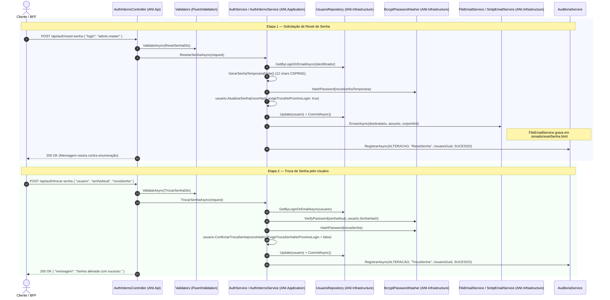

# Evolução de Autenticação: Fluxo de Reset e Troca de Senha de Usuário + Provedor de E-mail Desacoplado

## 1. Visão Geral da Implementação

Esta evolução adiciona o ciclo completo de **recuperação (`POST /api/auth/reset-senha`) e troca de senha (`POST /api/auth/trocar-senha`)** na API **ANI Core (Portal Itapemirim)** em C# / ASP.NET Core, respeitando a arquitetura em camadas (`Domain`, `Application`, `Infrastructure`, `Api`), a proteção contra enumeração de usuários (anti-account enumeration), o hashing criptográfico com **BCrypt**, a geração de senha temporária forte via CSPRNG (`RandomNumberGenerator`), o controle da flag `ExigeTrocaSenhaNoProximoLogin` e o desacoplamento do provedor de envio de e-mail (`IEmailService` com `FileEmailService` ativo por padrão e `SmtpEmailService` pronto para ativação via `appsettings.json`).

---

## 2. Arquitetura e Fluxo de Execução



---

## 3. Inventário de Arquivos Criados e Alterados

### A. Camada de Domínio e Infraestrutura (`ANI.Domain` / `ANI.Infrastructure`)

| Arquivo | Ação | Descrição |
| :--- | :--- | :--- |
| [`Usuario.cs`](file:///C:/Users/Duilio%20Farias/source/repos/portal_ItapemirimCore/src/Itapemirim.Ani.Domain/Entities/Usuario.cs) | **Alterado** | Adicionada a propriedade `ExigeTrocaSenhaNoProximoLogin` (`bool`), sobrecarga em `AtualizarSenha(string novoHash, bool exigeTrocaNoProximoLogin = false)` e método `ConfirmarTrocaSenha(string novoHash)` que atualiza o hash e redefine `ExigeTrocaSenhaNoProximoLogin = false`. |
| [`IUsuarioRepository.cs`](file:///C:/Users/Duilio%20Farias/source/repos/portal_ItapemirimCore/src/Itapemirim.Ani.Domain/Interfaces/IUsuarioRepository.cs) | **Alterado** | Adicionados métodos `GetByEmailAsync` e `GetByLoginOrEmailAsync`. |
| [`UsuarioRepository.cs`](file:///C:/Users/Duilio%20Farias/source/repos/portal_ItapemirimCore/src/Itapemirim.Ani.Infrastructure/Data/Repositories/UsuarioRepository.cs) | **Alterado** | Implementação das buscas `GetByEmailAsync` e `GetByLoginOrEmailAsync` (case-insensitive para login e e-mail). |
| [`UsuarioConfiguration.cs`](file:///C:/Users/Duilio%20Farias/source/repos/portal_ItapemirimCore/src/Itapemirim.Ani.Infrastructure/Data/Configurations/UsuarioConfiguration.cs) | **Alterado** | Mapeamento EF Core da coluna `ExigeTrocaSenhaNoProximoLogin` com valor padrão `false`. |
| [`FileEmailService.cs`](file:///C:/Users/Duilio%20Farias/source/repos/portal_ItapemirimCore/src/Itapemirim.Ani.Infrastructure/Email/FileEmailService.cs) | **Criado** | Implementação local de `IEmailService` que garante a existência do diretório `./emails/` e grava `./emails/resetSenha.html` (além de cópia histórica com timestamp `./emails/resetSenha_{yyyyMMdd_HHmmss}.html`). |
| [`SmtpEmailService.cs`](file:///C:/Users/Duilio%20Farias/source/repos/portal_ItapemirimCore/src/Itapemirim.Ani.Infrastructure/Email/SmtpEmailService.cs) | **Criado** | Estrutura pronta de envio SMTP (`SmtpClient` / `MailMessage`) parametrizada via `Email:Smtp:*` no `appsettings.json`. |
| [`DependencyInjection.cs`](file:///C:/Users/Duilio%20Farias/source/repos/portal_ItapemirimCore/src/Itapemirim.Ani.Infrastructure/DependencyInjection.cs) | **Alterado** | Registro condicional em DI via Feature Flag `Email:Provider` (`"File"` por padrão ou `"Smtp"`). |

### B. Camada de Aplicação (`ANI.Application`)

| Arquivo | Ação | Descrição |
| :--- | :--- | :--- |
| [`IEmailService.cs`](file:///C:/Users/Duilio%20Farias/source/repos/portal_ItapemirimCore/src/Itapemirim.Ani.Application/Interfaces/IEmailService.cs) | **Criado** | Contrato `Task EnviarAsync(string destinatario, string assunto, string corpoHtml, CancellationToken ct = default)`. |
| [`ResetSenhaDto.cs`](file:///C:/Users/Duilio%20Farias/source/repos/portal_ItapemirimCore/src/Itapemirim.Ani.Application/DTOs/Auth/ResetSenhaDto.cs) | **Criado** | DTO de entrada para solicitação de reset (`login`, `email` ou `identificador`). |
| [`ResetSenhaResponse.cs`](file:///C:/Users/Duilio%20Farias/source/repos/portal_ItapemirimCore/src/Itapemirim.Ani.Application/DTOs/Auth/ResetSenhaResponse.cs) | **Criado** | DTO de resposta padronizada do reset (`Mensagem` e `ProcessadoEmUtc`). |
| [`ResetSenhaValidator.cs`](file:///C:/Users/Duilio%20Farias/source/repos/portal_ItapemirimCore/src/Itapemirim.Ani.Application/Validators/ResetSenhaValidator.cs) | **Criado** | Validador FluentValidation do payload de reset. |
| [`TrocarSenhaDto.cs`](file:///C:/Users/Duilio%20Farias/source/repos/portal_ItapemirimCore/src/Itapemirim.Ani.Application/DTOs/Auth/TrocarSenhaDto.cs) | **Criado** | DTO de entrada para troca de senha contendo `usuario` (ou `login`/`email`), `senhaAtual` e `novaSenha`. |
| [`TrocarSenhaResponse.cs`](file:///C:/Users/Duilio%20Farias/source/repos/portal_ItapemirimCore/src/Itapemirim.Ani.Application/DTOs/Auth/TrocarSenhaResponse.cs) | **Criado** | DTO de saída para confirmação da troca de senha (`Mensagem` e `AlteradoEmUtc`). |
| [`TrocarSenhaValidator.cs`](file:///C:/Users/Duilio%20Farias/source/repos/portal_ItapemirimCore/src/Itapemirim.Ani.Application/Validators/TrocarSenhaValidator.cs) | **Criado** | Validador FluentValidation garantindo preenchimento de `usuario`, `senhaAtual`, `novaSenha` (mínimo 8 caracteres) e que `novaSenha != senhaAtual`. |
| [`IAuthInternoService.cs`](file:///C:/Users/Duilio%20Farias/source/repos/portal_ItapemirimCore/src/Itapemirim.Ani.Application/Interfaces/IAuthInternoService.cs) | **Alterado** | Inclusão das assinaturas `ResetarSenhaAsync` e `TrocarSenhaAsync`. |
| [`AuthInternoService.cs`](file:///C:/Users/Duilio%20Farias/source/repos/portal_ItapemirimCore/src/Itapemirim.Ani.Application/Services/AuthInternoService.cs) | **Alterado** | Implementação de `ResetarSenhaAsync` e `TrocarSenhaAsync`, gerador criptográfico de senha temporária, template HTML corporativo, atualização com BCrypt, registro de auditoria e claim JWT `requires_password_change`. |
| [`AuthService.cs`](file:///C:/Users/Duilio%20Farias/source/repos/portal_ItapemirimCore/src/Itapemirim.Ani.Application/Services/AuthService.cs) | **Criado** | Classe de serviço `AuthService` expondo `ResetarSenhaAsync(...)` e `TrocarSenhaAsync(...)`. |

### C. Camada de API (`ANI.Api`) e Testes (`tests/`)

| Arquivo | Ação | Descrição |
| :--- | :--- | :--- |
| [`AuthInternoController.cs`](file:///C:/Users/Duilio%20Farias/source/repos/portal_ItapemirimCore/src/Itapemirim.Ani.Api/Controllers/AuthInternoController.cs) | **Alterado** | Endpoints `ResetSenha` (`POST /api/auth/reset-senha`, `/api/v1/auth/reset-senha`) e `TrocarSenha` (`POST /api/auth/trocar-senha`, `/api/auth/alterar-senha`, `/api/v1/auth/trocar-senha`) anotados com `[ProducesResponseType]`. |
| [`appsettings.json`](file:///C:/Users/Duilio%20Farias/source/repos/portal_ItapemirimCore/src/Itapemirim.Ani.Api/appsettings.json) | **Alterado** | Seção `"Email"` configurada com `"Provider": "File"`, `"FileOutputDirectory": "./emails"` e bloco `"Smtp"` estruturado para uso futuro. |
| [`Program.cs`](file:///C:/Users/Duilio%20Farias/source/repos/portal_ItapemirimCore/src/Itapemirim.Ani.Api/Program.cs) | **Alterado** | Verificação automática da coluna `ExigeTrocaSenhaNoProximoLogin` no SQLite em ambiente de desenvolvimento. |
| [`ResetSenhaTests.cs`](file:///C:/Users/Duilio%20Farias/source/repos/portal_ItapemirimCore/tests/Itapemirim.Ani.UnitTests/ResetSenhaTests.cs) | **Criado** | Testes unitários cobrindo reset de usuário ativo, proteção de usuário inexistente e troca de senha (`TrocarSenhaAsync`). |

---

## 4. Detalhamento do Código Implementado

### 4.1. Interface `IEmailService` e Provedores (`FileEmailService` & `SmtpEmailService`)

- **[`IEmailService.cs`](file:///C:/Users/Duilio%20Farias/source/repos/portal_ItapemirimCore/src/Itapemirim.Ani.Application/Interfaces/IEmailService.cs)**:
```csharp
namespace Itapemirim.Ani.Application.Interfaces;

public interface IEmailService
{
    Task EnviarAsync(string destinatario, string assunto, string corpoHtml, CancellationToken ct = default);
}
```

- **[`FileEmailService.cs`](file:///C:/Users/Duilio%20Farias/source/repos/portal_ItapemirimCore/src/Itapemirim.Ani.Infrastructure/Email/FileEmailService.cs)**:
```csharp
public class FileEmailService : IEmailService
{
    private readonly ILogger<FileEmailService> _logger;
    private readonly string _outputDirectory;

    public FileEmailService(IConfiguration configuration, ILogger<FileEmailService> logger)
    {
        _logger = logger;
        var configuredDir = configuration["Email:FileOutputDirectory"];
        _outputDirectory = !string.IsNullOrWhiteSpace(configuredDir)
            ? Path.GetFullPath(configuredDir, Directory.GetCurrentDirectory())
            : Path.Combine(Directory.GetCurrentDirectory(), "emails");
    }

    public async Task EnviarAsync(string destinatario, string assunto, string corpoHtml, CancellationToken ct = default)
    {
        Directory.CreateDirectory(_outputDirectory);

        var defaultFilePath = Path.Combine(_outputDirectory, "resetSenha.html");
        var timestampedFilePath = Path.Combine(_outputDirectory, $"resetSenha_{DateTime.UtcNow:yyyyMMdd_HHmmss}.html");

        await File.WriteAllTextAsync(defaultFilePath, corpoHtml, Encoding.UTF8, ct);
        await File.WriteAllTextAsync(timestampedFilePath, corpoHtml, Encoding.UTF8, ct);

        _logger.LogInformation(
            "E-mail simulado (FileEmailService) gravado com sucesso para '{Destinatario}' com assunto '{Assunto}'. Arquivo principal: {FilePath}",
            destinatario,
            assunto,
            defaultFilePath);
    }
}
```

---

### 4.2. Casos de Uso `ResetarSenhaAsync` e `TrocarSenhaAsync` (`ANI.Application`)

Em [`AuthInternoService.cs`](file:///C:/Users/Duilio%20Farias/source/repos/portal_ItapemirimCore/src/Itapemirim.Ani.Application/Services/AuthInternoService.cs):
```csharp
public async Task<ResetSenhaResponse> ResetarSenhaAsync(ResetSenhaDto request, CancellationToken ct = default)
{
    var identificador = request.ValorIdentificador;
    var usuario = await _usuarioRepo.GetByLoginOrEmailAsync(identificador, ct);

    if (usuario == null || usuario.Status != UsuarioStatus.Ativo)
    {
        await _auditoria.RegistrarAsync(
            TipoAcaoAuditoria.ALTERACAO,
            "ResetSenha",
            identificador,
            ResultadoAuditoria.FALHA,
            ct);

        return new ResetSenhaResponse(MensagemPadraoResetSenha, DateTime.UtcNow);
    }

    var novaSenhaTemporaria = GerarSenhaTemporariaForte();
    var novoHash = _hasher.HashPassword(novaSenhaTemporaria);

    usuario.AtualizarSenha(novoHash, exigeTrocaNoProximoLogin: true);
    _usuarioRepo.Update(usuario);
    await _uow.CommitAsync(ct);

    var destinatario = !string.IsNullOrWhiteSpace(usuario.Email)
        ? usuario.Email
        : $"{usuario.Login}@itapemirim.local";

    var assunto = "Portal Corporativo ANI — Redefinição de Senha de Acesso";
    var corpoHtml = MontarTemplateHtmlResetSenha(usuario, novaSenhaTemporaria);

    await _emailService.EnviarAsync(destinatario, assunto, corpoHtml, ct);

    await _auditoria.RegistrarAsync(
        TipoAcaoAuditoria.ALTERACAO,
        "ResetSenha",
        usuario.UsuarioGuid.ToString(),
        ResultadoAuditoria.SUCESSO,
        ct);

    return new ResetSenhaResponse(MensagemPadraoResetSenha, DateTime.UtcNow);
}

public async Task<TrocarSenhaResponse> TrocarSenhaAsync(TrocarSenhaDto request, CancellationToken ct = default)
{
    var identificador = request.ValorUsuario;
    var usuario = await _usuarioRepo.GetByLoginOrEmailAsync(identificador, ct);

    if (usuario == null || !_hasher.VerifyPassword(request.SenhaAtual, usuario.SenhaHash))
    {
        await _auditoria.RegistrarAsync(
            TipoAcaoAuditoria.ALTERACAO,
            "TrocaSenha",
            identificador,
            ResultadoAuditoria.FALHA,
            ct);

        throw new RegraNegocioException("Usuário ou senha atual inválidos.");
    }

    if (usuario.Status != UsuarioStatus.Ativo)
    {
        await _auditoria.RegistrarAsync(
            TipoAcaoAuditoria.ALTERACAO,
            "TrocaSenha",
            usuario.UsuarioGuid.ToString(),
            ResultadoAuditoria.FALHA,
            ct);

        throw new RegraNegocioException($"Não é possível alterar a senha pois o usuário está com status '{usuario.Status}'.");
    }

    if (_hasher.VerifyPassword(request.NovaSenha, usuario.SenhaHash))
    {
        throw new RegraNegocioException("A nova senha deve ser diferente da senha atual.");
    }

    var novoHash = _hasher.HashPassword(request.NovaSenha);
    usuario.ConfirmarTrocaSenha(novoHash);

    _usuarioRepo.Update(usuario);
    await _uow.CommitAsync(ct);

    await _auditoria.RegistrarAsync(
        TipoAcaoAuditoria.ALTERACAO,
        "TrocaSenha",
        usuario.UsuarioGuid.ToString(),
        ResultadoAuditoria.SUCESSO,
        ct);

    return new TrocarSenhaResponse("Senha alterada com sucesso.", DateTime.UtcNow);
}
```

---

### 4.3. Endpoints no Controller (`ANI.Api`)

Em [`AuthInternoController.cs`](file:///C:/Users/Duilio%20Farias/source/repos/portal_ItapemirimCore/src/Itapemirim.Ani.Api/Controllers/AuthInternoController.cs):
```csharp
[HttpPost("reset-senha")]
[HttpPost("forgot-password")]
[HttpPost("/api/auth/reset-senha")]
[HttpPost("/api/auth/forgot-password")]
[ProducesResponseType(typeof(ResetSenhaResponse), StatusCodes.Status200OK)]
[ProducesResponseType(typeof(ProblemDetails), StatusCodes.Status400BadRequest)]
public async Task<IActionResult> ResetSenha(
    [FromBody] ResetSenhaDto? request,
    [FromServices] IValidator<ResetSenhaDto> validator,
    CancellationToken ct)
{
    if (request is null)
    {
        throw new ValidationException(new[]
        {
            new FluentValidation.Results.ValidationFailure("identificador", "O payload da requisição é obrigatório.")
        });
    }

    var validacao = await validator.ValidateAsync(request, ct);
    if (!validacao.IsValid)
    {
        throw new ValidationException(validacao.Errors);
    }

    var result = await _service.ResetarSenhaAsync(request, ct);
    return Ok(result);
}

[HttpPost("trocar-senha")]
[HttpPost("alterar-senha")]
[HttpPost("change-password")]
[HttpPost("/api/auth/trocar-senha")]
[HttpPost("/api/auth/alterar-senha")]
[HttpPost("/api/auth/change-password")]
[ProducesResponseType(typeof(TrocarSenhaResponse), StatusCodes.Status200OK)]
[ProducesResponseType(typeof(ProblemDetails), StatusCodes.Status400BadRequest)]
[ProducesResponseType(typeof(ProblemDetails), StatusCodes.Status422UnprocessableEntity)]
public async Task<IActionResult> TrocarSenha(
    [FromBody] TrocarSenhaDto? request,
    [FromServices] IValidator<TrocarSenhaDto> validator,
    CancellationToken ct)
{
    if (request is null)
    {
        throw new ValidationException(new[]
        {
            new FluentValidation.Results.ValidationFailure("payload", "O payload da requisição é obrigatório.")
        });
    }

    var validacao = await validator.ValidateAsync(request, ct);
    if (!validacao.IsValid)
    {
        throw new ValidationException(validacao.Errors);
    }

    var result = await _service.TrocarSenhaAsync(request, ct);
    return Ok(result);
}
```

---

## 5. Exemplos de Teste (cURL e Verificação Passo a Passo)

### Passo 1: Subir a API e Popular o Banco (se necessário)
```powershell
dotnet run --project src/Itapemirim.Ani.Api
```
*(Em outro terminal, caso o banco tenha sido recriado, execute `.\scripts\seed_database_api.ps1` para criar o usuário `admin.master` / `admin.master@itapemirim.com.br`).*

---

### Passo 2: Solicitar o Reset de Senha via `curl`

```bash
curl -i -X POST "http://localhost:5146/api/auth/reset-senha" \
  -H "Content-Type: application/json" \
  -d '{
    "login": "admin.master"
  }'
```

#### Resposta HTTP (`200 OK`):
```http
HTTP/1.1 200 OK
Content-Type: application/json; charset=utf-8

{
  "mensagem": "Se as informações informadas corresponderem a uma conta ativa, você receberá um e-mail com as instruções e a senha temporária de acesso.",
  "processadoEmUtc": "2026-11-01T16:45:00.1234567Z"
}
```

---

### Passo 3: Inspecionar o Arquivo `./emails/resetSenha.html` Gerado

```powershell
# Visualizar o HTML no terminal ou abrir diretamente no navegador padrão:
Get-Content .\src\Itapemirim.Ani.Api\emails\resetSenha.html
Invoke-Item .\src\Itapemirim.Ani.Api\emails\resetSenha.html
```

No bloco central **"Sua Nova Senha Temporária"**, copie a senha gerada (ex.: `K9#mP4!xQ2@v`).

---

### Passo 4: Realizar a Troca de Senha (`POST /api/auth/trocar-senha`)

Informe o `usuario` (login ou e-mail), a `senhaAtual` (a senha temporária recebida no HTML) e a `novaSenha` definitiva:

```bash
curl -i -X POST "http://localhost:5146/api/auth/trocar-senha" \
  -H "Content-Type: application/json" \
  -d '{
    "usuario": "admin.master",
    "senhaAtual": "<SENHA_TEMPORARIA_EXTRAIDA_DO_HTML>",
    "novaSenha": "NovaSenhaForte@2026"
  }'
```

#### Resposta HTTP (`200 OK`):
```http
HTTP/1.1 200 OK
Content-Type: application/json; charset=utf-8

{
  "mensagem": "Senha alterada com sucesso.",
  "alteradoEmUtc": "2026-11-01T17:02:10.4512389Z"
}
```

---

### Passo 5: Autenticar com a Nova Senha Definitiva

```bash
curl -i -X POST "http://localhost:5146/api/auth/login" \
  -H "Content-Type: application/json" \
  -d '{
    "login": "admin.master",
    "senha": "NovaSenhaForte@2026"
  }'
```

- O login retorna `200 OK` com o token JWT emitido e `"exigeTrocaSenhaNoProximoLogin": false` (claim `"requires_password_change": "false"`).
